  <a href="https://arav-portfolio.vercel.app"><b>Portfolio</b></a>&nbsp;&nbsp;·&nbsp;&nbsp;
  <a href="https://www.linkedin.com/in/arav-saxena-a081a428a/"><b>LinkedIn</b></a>&nbsp;&nbsp;·&nbsp;&nbsp;
  <a href="https://arav-portfolio.vercel.app/resume.pdf"><b>Résumé</b></a>&nbsp;&nbsp;·&nbsp;&nbsp;
  <a href="mailto:aravsaxena884@gmail.com"><b>aravsaxena884@gmail.com</b></a>&nbsp;&nbsp;·&nbsp;&nbsp;
  <a href="https://leetcode.com/u/arav_7782/"><b>LeetCode</b></a>

## About

I'm a backend engineer who also ships the front end. Most of my time goes into the middle of a system: the services, the event pipelines between them, and the data they must never get wrong.

- **Now** — SDE intern at **Bajaj Finserv Health** (Jul 2026 – present) on the payments and order-management platform: NestJS/TypeScript microservices on Azure Kubernetes Service behind an APIM gateway, handling payins, transfers, refunds, recurring payments and QR settlement. I build the Kafka payment-event pipelines (Avro contracts in a schema registry, consumers that commit only after processing, dead-letter topics), designed the topic topology for a Java claims pipeline that turns partner XML feeds into typed, versioned events, and work on Azure DevOps CI/CD. I also build ingestion workflows for an internal knowledge-graph platform (FastAPI, Temporal, Neo4j, PostgreSQL + pgvector).
- **Before** — research intern at the Symbiosis Centre for Applied AI (2025 – 26) and intern at C-DAC (2025), where I built a natural-language-to-SQL reporting assistant.
- **Studying** — B.Tech, Symbiosis Institute of Technology, Pune (2023 – 27).
- **Open to** backend and full-stack SDE roles. Email or LinkedIn reaches me fastest.

## How I build backends

- **At-least-once delivery, exactly-once effects.** Offsets are committed after the side effect and events are de-duplicated by id, so a retry never charges anyone twice.
- **Contracts before code.** Events are typed, versioned Avro records checked against a schema registry, so a breaking change fails at publish time instead of in someone else's consumer.
- **Park bad messages, keep the partition moving.** Poison messages go to a dead-letter topic where they can be inspected and replayed.
- **State you can audit.** CQRS, event sourcing and SAGA compensation rather than distributed transactions, and a single entity-lifecycle table that records every state change across systems.

## Selected work

<table>
<tr>
<td width="50%" valign="top">

**[TreadOps](https://github.com/arav7781/TREADOPS)** — inspection platform 
FastAPI service with 18 routers, SQLAlchemy and Alembic migrations on PostgreSQL, Celery workers on Redis, S3-compatible object storage, role-based access and an audit log. Next.js 16 front end with Playwright e2e tests, Docker Compose, CI. Vision models and a gated model-release loop sit behind the API. 
FastAPI · PostgreSQL · Celery · Redis · Next.js · Docker

</td>
<td width="50%" valign="top">

**[Topology Cartographer](https://github.com/arav7781/service-topology)** — service maps from source 
Reads a codebase's Kafka, RabbitMQ, SQS, NATS and Pub/Sub bindings, its REST, gRPC and GraphQL calls and its datastores, cites every arrow to a file and line, and draws the view a question needs: one service's neighbourhood, a topic's lineage, or the blast radius of a change. 
Kafka · gRPC · REST · Mermaid · draw.io

</td>
</tr>
<tr>
<td width="50%" valign="top">

**[DelayLens](https://github.com/arav7781/delaylens)** — supply-chain data pipeline 
180,519 order lines through 33 Hadoop MapReduce jobs on YARN (Python Streaming and native Java), reconciled across engines and served from MongoDB by a FastAPI API that streams into an 8-page Next.js dashboard over server-sent events. Found why 54.8% of deliveries ran late. 
Hadoop · Java · MongoDB · FastAPI · Next.js

</td>
<td width="50%" valign="top">

**[AgentLatch](https://github.com/arav7781/AgentLatch)** — Python middleware on [PyPI](https://pypi.org/project/agentlatch/) 
Zero-dependency library that catches failing tool calls and returns structured errors instead of crashing, traces latency, ships FastAPI/Starlette middleware and a permission-gated sandbox with Postgres, Qdrant and Neo4j memory backends. 
Python · FastAPI · Docker · <code>pip install agentlatch</code>

</td>
</tr>
<tr>
<td width="50%" valign="top">

**[Portfolio](https://github.com/arav7781/arav-portfolio)** — [arav-portfolio.vercel.app](https://arav-portfolio.vercel.app) 
Next.js 15 and TypeScript site with a WebGL hero, an interactive Kafka simulation (keyed partitions, consumer groups, idempotent redelivery, a DLQ) and a graph view of my work. 
Next.js · TypeScript · Three.js · Tailwind

</td>
<td width="50%" valign="top">

**[Graph Hierarchy API](https://github.com/arav7781/aravsaxena-bfhl)** — REST API, layered design 
Node.js/Express service built as small injected components (parser, validator, union-find grouping, cycle detection, tree builder), with a Next.js client in [iskconVoice](https://github.com/arav7781/iskconVoice). 
Node.js · Express · Next.js

</td>
</tr>
<tr>
<td width="50%" valign="top">

**[FinAgent](https://github.com/arav7781/FinAgent)** — due-diligence service 
FastAPI service with Docker Compose, a written API reference, runnable examples and curl recipes. Reads a pitch deck, checks the company registry and writes a PDF report. 
FastAPI · LangGraph · Docker

</td>
<td width="50%" valign="top">

**[BharatHire](https://github.com/arav7781/bharatHireSecure)** — interview proctoring 
Node.js/Express API that detects and stops overlay apps during an interview, with session audit logs and analytics, plus a Next.js and LiveKit (WebRTC) interview room. 
Node.js · Express · Next.js · WebRTC

</td>
</tr>
</table>

## Toolbox

    
    
    
    
  

Also: Avro and Schema Registry, Axon Framework, EventStoreDB, Neo4j, Temporal, ArgoCD, Azure DevOps, AKHQ, Grafana, Splunk. On the ML side: LangGraph, RAG, PyTorch.

## On GitHub

  <picture>
    <source media="(prefers-color-scheme: dark)" srcset="https://github-readme-stats.vercel.app/api?username=arav7781&show_icons=true&hide_rank=true&count_private=true&bg_color=0d1117&title_color=e6edf3&text_color=8b949e&icon_color=fb923c&border_color=30363d&border_radius=8">
    
  </picture>
  <picture>
    <source media="(prefers-color-scheme: dark)" srcset="https://github-readme-stats.vercel.app/api/top-langs/?username=arav7781&layout=compact&langs_count=6&hide=jupyter%20notebook,html,css&bg_color=0d1117&title_color=e6edf3&text_color=8b949e&border_color=30363d&border_radius=8">
    
  </picture>

<picture>
  <source media="(prefers-color-scheme: dark)" srcset="https://leetcard.jacoblin.cool/arav_7782?theme=dark&font=Inter&ext=heatmap">
  
</picture>

## Also

- Paper: *AgCV: An Agentic Framework for Automating Computer Vision Applications*, published in [MethodsX (Elsevier)](https://www.sciencedirect.com/science/article/pii/S2215016124003498).
- Three published Indian patents (agentic computer vision, legal reasoning support, automated query execution).
- 3rd place at Hack Your Path 6.0 (HITAM and GDG, 2025, team lead) and at the AG Patil hackathon (2025).
- Courses and certificates: Anthropic (Advanced MCP), Nutanix Certified Associate, Stanford Online algorithms ([list](https://github.com/arav7781/Certifications)).
